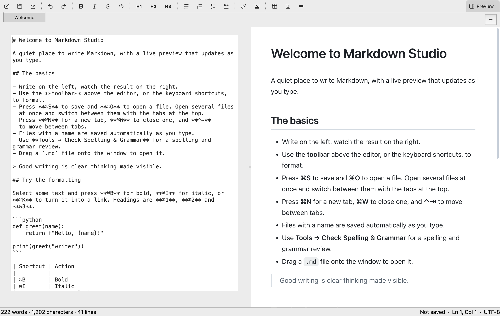

# Markdown Studio



A small, fast Markdown editor for the Ubuntu desktop. The window is split in
half: a toolbar-driven editor on the left and a live preview on the right.

## Features

- Split view: Markdown editor with a formatting toolbar, live preview beside it.
- Tabs for multiple open files, with a close button on every tab. Open several
  files at once from the file chooser, the command line, or by dragging them in.
- Automatic saving of named files while you type, plus a save-on-close pass so
  an accidental close does not lose changes.
- Spelling and grammar review through LanguageTool (online; optional and only
  runs when you choose **Tools → Check Spelling & Grammar**). Suspected words
  are underlined in the editor, and applying one suggestion refreshes the
  review in place instead of closing it.
- Live preview with GitHub-style typography, tables, task lists, syntax
  highlighting (Pygments) and local/remote images.
- Toolbar for bold, italic, strikethrough, inline code, headings, quotes, lists,
  task lists, links, images, tables, code blocks and horizontal rules.
- Keyboard shortcuts for everything you do often.
- Undo/redo with sensible grouping, even though this GTK build ships without
  `GtkTextBuffer` undo.
- Open, save, save-as and export to a standalone HTML file.
- Drag a `.md` file onto the window to open it.
- Automatic light/dark preview that follows the desktop colour scheme.
- Scroll position is mirrored from the editor to the preview.
- Word, character and line counts, plus cursor position.

## Requirements

Everything is already installed on a standard Ubuntu 26.04 desktop:

```bash
python3-gi gir1.2-gtk-3.0 gir1.2-handy-1 gir1.2-webkit2-4.1 \
python3-markdown-it python3-pygments
```

Check with:

```bash
python3 -c "import gi, markdown_it, pygments; gi.require_version('Gtk','3.0'); \
gi.require_version('WebKit2','4.1'); print('ready')"
```

## Install

```bash
./install.sh
```

This copies the app to `~/.local/opt/markdown-studio`, adds a
`markdown-studio` launcher in `~/.local/bin`, and installs a desktop entry and
icon, so the app also shows up in the GNOME application grid. It also makes
Markdown Studio the explicit default handler for `text/markdown`, so a later
editor install cannot silently take over the association.

## Uninstall

```bash
./uninstall.sh
```

This removes the launcher, app directory, desktop entry and icon. If Markdown
Studio is still the default `text/markdown` handler, the uninstaller also drops
that association.

## Run

```bash
markdown-studio                 # start with the welcome document
markdown-studio notes.md        # open a file
markdown-studio a.md b.md       # open several files in tabs
python3 app.py notes.md         # run without installing
```

## Shortcuts

| Action | Shortcut |
| --- | --- |
| New / Open / Save / Save As | `Ctrl+N` / `Ctrl+O` / `Ctrl+S` / `Ctrl+Shift+S` |
| Close file | `Ctrl+W` |
| Next / previous tab | `Ctrl+Tab` / `Ctrl+Shift+Tab` |
| Export as HTML | `Ctrl+Shift+E` |
| Check spelling & grammar | `Ctrl+Shift+G` |
| Undo / Redo | `Ctrl+Z` / `Ctrl+Shift+Z` |
| Bold / Italic / Strikethrough | `Ctrl+B` / `Ctrl+I` / `Ctrl+Shift+X` |
| Inline code / Code block | `Ctrl+E` / `Ctrl+Shift+C` |
| Link / Image | `Ctrl+K` / `Ctrl+Shift+I` |
| Heading 1 / 2 / 3 | `Ctrl+1` / `Ctrl+2` / `Ctrl+3` |
| Bulleted / Numbered / Task list | `Ctrl+Shift+8` / `Ctrl+Shift+7` (task via toolbar) |
| Block quote | `Ctrl+Shift+9` |
| Toggle preview | `Ctrl+Shift+P` |
| Fullscreen | `F11` |
| Quit | `Ctrl+Q` |

## Notes

- Raw HTML in a document is escaped, not executed.
- Clicking a `http(s)` link opens it in your browser; clicking a link to a local
  Markdown file opens that file in the editor.
- Relative image paths resolve against the document's folder.
- The preview is rendered by WebKitGTK with a small GitHub-flavoured stylesheet;
  code blocks are highlighted by Pygments.
- Saves are atomic: the document is written to a temporary file and renamed
  into place, so a crash or power loss cannot leave a truncated file.
- Named files are auto-saved after a short pause in typing. Untitled documents
  still ask where to save when you close them.
- Spelling and grammar checks send the document text to
  `api.languagetool.org` only when you run the check. QuillBot's API requires a
  paid account, so LanguageTool is used instead. Set
  `MARKDOWN_STUDIO_GRAMMAR_URL` and `MARKDOWN_STUDIO_GRAMMAR_LANGUAGE` to use a
  self-hosted LanguageTool server or another language.

## Files

| File | Purpose |
| --- | --- |
| `app.py` | the whole application |
| `markdown-studio.svg` | application icon |
| `markdown-studio.desktop` | desktop entry template |
| `install.sh` | per-user installer |
| `uninstall.sh` | per-user uninstaller |
